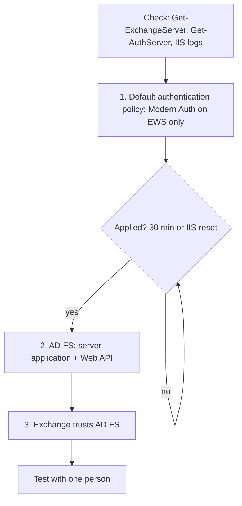

# Administrator guide

What the Exchange, AD FS and platform administrators do for each sign-in mode. Every step names who
does it and how to check it worked.

## Both modes

| # | Who | What | Check |
|---|---|---|---|
| 1 | DNS | a name for this server, reachable by people's browsers and by the MCP client | `nslookup` from a workstation |
| 2 | PKI | a certificate for that name, trusted by the MCP client | the client connects without a warning |
| 3 | Network | this server reaches the EWS URL (`/EWS/Exchange.asmx`) on 443; in `adfs` mode also AD FS on 443 | `curl -sI <EWS URL>` from the pod answers 401 |
| 4 | Platform | the CA bundle that signs Exchange's and AD FS's certificates, mounted as a file (`EXCHANGE_MCP_CA_BUNDLE`) when they use an internal CA | the pod's sign-in check reaches EWS |
| 5 | Platform | the sealing key: Vault or OpenBao transit (`vault`), or a Secret generated at deploy (`file`); see [auth-modes](auth-modes.md#the-sealing-key) | the server starts; a key in the environment stops it |
| 6 | Exchange | automatic forwarding to external domains off | `Get-RemoteDomain \| ft DomainName,AutoForwardEnabled` |

```powershell
# step 6; check first whether any agreed external forwarding exists, and give it its own remote domain
Get-RemoteDomain | Format-Table DomainName, AutoForwardEnabled
Set-RemoteDomain Default -AutoForwardEnabled $false
```

## `password` mode

Exchange and AD FS need nothing beyond the steps above. The operator sets:

| Setting | Value |
|---|---|
| `EXCHANGE_MCP_AUTH_MODE` | `password` |
| `EXCHANGE_MCP_LOGIN_FORMAT` | `upn` or `down_level`: the form Exchange accepts for NTLM |
| `EXCHANGE_MCP_LOGIN_DOMAIN` | the UPN suffix (`upn`) or the NetBIOS domain (`down_level`) |
| `EXCHANGE_MCP_LOGIN_ALSO` | the organisation's other spelling, exactly: the UPN suffix in `down_level`, the NetBIOS name in `upn` (comma-separated) |
| `EXCHANGE_MCP_ATTEMPTS_PER_LOGIN` | below the directory's lockout threshold (one replica: the count is kept in the process) |

Read the risks in [auth-modes](auth-modes.md#the-risks-of-password-and-what-holds-each) with the security
team before turning this mode on.

## `adfs` mode

Requires Exchange Server 2019 CU13 or later, or Subscription Edition, on every server that accepts client
connections (mailbox servers behind them may be older), `Setup /PrepareAD` run from that media, and AD FS
on Windows Server 2019 or later.



### Before anything

```powershell
Get-ExchangeServer | Format-Table Name, ServerRole, AdminDisplayVersion   # client-facing: 2019 CU13+ or SE
Get-AuthServer | Format-List Name, Type, Enabled, IsDefaultAuthorizationEndpoint, AuthMetadataUrl
Get-OrganizationConfig | Format-List OAuth2ClientProfileEnabled, DefaultAuthenticationPolicy
```

An auth server pointing at a cloud tenant the organisation no longer uses is a stale trust: check the
front-end IIS logs for successful Bearer requests over a week, and remove it if there are none.

### 1. Modern Auth on EWS only (Exchange)

Do this before Exchange trusts AD FS, because Outlook and phones may switch to AD FS sign-in when step 3 turns
Modern Auth on for the organisation. Carry over any `BlockLegacyAuth*` the current default policy has.

```powershell
New-AuthenticationPolicy "Modern Auth EWS only" -BlockModernAuthActiveSync -BlockModernAuthAutodiscover `
  -BlockModernAuthImap -BlockModernAuthMapi -BlockModernAuthOfflineAddressBook `
  -BlockModernAuthPop -BlockModernAuthRpc
Set-OrganizationConfig -DefaultAuthenticationPolicy "Modern Auth EWS only"
```

Microsoft has no ready recipe for "EWS only"; test it on one person, including clients that use EWS
themselves (Outlook for Mac).

### 2. AD FS

| What | Value |
|---|---|
| Scope descriptions | `EWS.AccessAsUser.All`, `offline_access` (`Add-AdfsScopeDescription`) if absent |
| Server application (confidential client) | `Add-AdfsServerApplication`, key authentication with this server's public key (`-JWTSigningCertificate` or `-JWKSUri`), redirect URI `https://<this server>/adfs/callback` |
| Web API | identifier = the Exchange URL (`EXCHANGE_MCP_ADFS_RESOURCE`), claim rules from Microsoft's guide (`primarysid`, `upn`, `appidacr`, `scp`); `scp` carries `user_impersonation EWS.AccessAsUser.All offline_access` and **not** `EAS.AccessAsUser.All` |
| Permission | `Grant-AdfsApplicationPermission` for the client to the Web API: `openid`, `user_impersonation`, `EWS.AccessAsUser.All`, `offline_access` |
| Token lifetime | one hour or less on the Web API; tell the operator `SsoLifetime` and whether KMSI is on |

The operator sets `EXCHANGE_MCP_ADFS_ISSUER`, `_CLIENT_ID`, `_KEY_FILE` (the private key, a mounted file),
`_KEY_ID` and `_RESOURCE`.

### 3. Exchange trusts AD FS

```powershell
New-AuthServer -Type ADFS -Name "ADFS" -AuthMetadataUrl https://<adfs host>/FederationMetadata/2007-06/FederationMetadata.xml
Set-AuthServer -Identity "ADFS" -IsDefaultAuthorizationEndpoint $true
Set-OrganizationConfig -OAuth2ClientProfileEnabled $true
```

### Test

| Check | Expected |
|---|---|
| A test person connects through the MCP client | the AD FS page, then the client is connected |
| `get_connection` | `sign_in: adfs` |
| The same AD FS token to `/mapi/` or `/Microsoft-Server-ActiveSync` | refused |
| Outlook on Windows and Mac | works as before |

### Rollback

| Depth | Action |
|---|---|
| Everyone, at once | disable the server application in AD FS |
| Completely | `Remove-AuthServer "ADFS"`; remove the application group and scope descriptions; the default policy stays |
